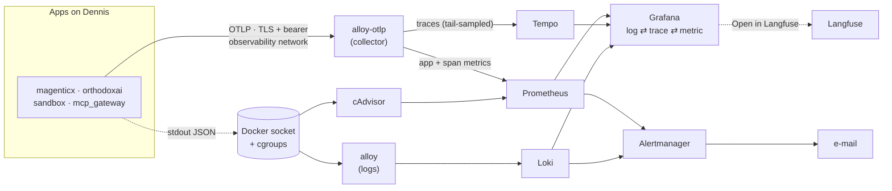

# monitoring

Grafana, Prometheus, Loki, Tempo, Alloy, cAdvisor, node-exporter and Alertmanager for **Dennis**, the shared Oracle Cloud VM. One stack watches everything deployed there, each in its own Grafana folder:

| Watched | Kind | Stack / Compose project | Grafana folder |
| --- | --- | --- | --- |
| mAgenticX | Swarm stack | `magenticx` | magenticX |
| OrthodoxAI | Swarm stack | `orthodoxai` | OrthodoxAI |
| Sandbox runner | Compose project | `sandbox` | Sandbox |
| MCP gateway | Compose project | `mcp_gateway` | MCP Gateway |
| The host + this pipeline | | | Dennis |

## How it works



| Signal | Path |
| --- | --- |
| Logs | Alloy reads the Docker socket and ships the four stacks' logs to Loki. Only `stack`, `service` and `level` become labels; `trace_id`, `thread_id` and the Langfuse links ride along as structured metadata (never labels). |
| Container + host metrics | cAdvisor and node-exporter, scraped by Prometheus. sandbox and mcp_gateway carry Compose labels, which are rebuilt Swarm-style (`<project>_<service>`) so every query works the same way. |
| App metrics + traces | Apps **push** OTLP to `alloy-otlp` over the neutral `observability` overlay (TLS + bearer token). The collector deletes content attributes, derives RED metrics and the service graph from 100% of spans, then tail-samples traces into Tempo (all errors, all traces > 5 s, 15% of the rest). |
| Agent internals | Langfuse (separate project), keyed by `thread_id`. Content (prompts, completions, tool I/O) lives **only** there; logs, traces and metrics stay content-free. |
| Alerts | Prometheus rules + Loki ruler → one Alertmanager: e-mail on Dennis, silent locally. |

The stack joins no app network. Logs come from the Docker socket, container metrics from cgroups, and everything else is pushed to `alloy-otlp`, the only monitoring service on the `observability` network. It runs without the Docker socket, as a non-root user, and keeps its HTTP server on `127.0.0.1`.

## Run locally

```bash
# once: a Grafana admin password and the OTLP secrets (all gitignored)
mkdir -p secrets
python -c "import secrets; open('secrets/grafana_admin_password','w').write(secrets.token_urlsafe(24))"
bash scripts/make-otlp-secrets.sh

docker compose up -d     # project `monitoring`; never touches an app container
docker compose down
```

Grafana runs at <http://localhost:3000> as user `admin`. It listens on 127.0.0.1 only and serves plain HTTP. The log panels want `LOG_FORMAT=json` in the app's `.env`.

### OTLP secrets

`scripts/make-otlp-secrets.sh` writes these files into `secrets/`. It never overwrites one, so delete a file to rotate it.

| File | What | Goes to |
| --- | --- | --- |
| `otlp_ca.crt` | Private "monitoring OTLP CA" (10 years) | Every app that pushes OTLP, so it can verify the collector |
| `otlp_ca.key` | The CA key | **Nowhere.** Keep it offline; it only signs a new server cert |
| `otlp_tls.crt`, `otlp_tls.key` | `alloy-otlp`'s server cert (2 years) | The collector (Swarm secrets `monitoring_otlp_tls_crt` / `_key`) |
| `otlp_bearer_token` | 64 hex characters, no newline | The collector (`monitoring_otlp_bearer_token`) and every app |

To try the pipeline locally, send test traces from the `observability` network:

```bash
docker run --rm --network observability -v "$(pwd -W)/secrets/otlp_ca.crt:/ca.crt:ro" \
  ghcr.io/open-telemetry/opentelemetry-collector-contrib/telemetrygen:v0.159.0 traces \
  --otlp-endpoint alloy-otlp:4317 --ca-cert /ca.crt \
  --otlp-header "Authorization=\"Bearer $(cat secrets/otlp_bearer_token)\"" \
  --traces 20 --child-spans 3 --status-code Error --service phaseA-test
```

## Dennis

The Portainer Swarm stack `monitoring` deploys [`docker-compose-denis.yml`](docker-compose-denis.yml). Every config is baked into a `monitoring_<service>` image ([`images/`](images/)), so a release is one tag bump in that file: CI ([`.github/workflows/pipeline.yml`](.github/workflows/pipeline.yml)) validates the configs, builds the new images natively on ARM64, scans them with Trivy, publishes them privately to GHCR and calls the Portainer webhook, then waits until the live Grafana reports the new tag. CD never logs into the VM. The operational runbook is kept privately.

## Layout

| Path | What |
| --- | --- |
| `docker-compose.yaml` | Local stack |
| `docker-compose-denis.yml` | Dennis Swarm stack |
| `prometheus.yml`, `alert.rules.yml` | Prometheus scrape + OTLP config, infra / container / pipeline alerts |
| `loki-config.yml`, `loki-rules.yml` | Loki + LogQL alert rules |
| `alloy-config.alloy` | Docker logs → Loki (+ correlation ids as structured metadata) |
| `alloy-otlp.alloy` | The OTLP collector: auth, redaction, span metrics, tail sampling → Tempo / Prometheus / Loki |
| `tempo-config.yml` | Tempo (local storage, 30-day retention) |
| `alertmanager.yml` | E-mail routing (Dennis) |
| `grafana/` | Datasources (with log ⇄ trace ⇄ metric ⇄ Langfuse links), dashboard providers, dashboards per folder |
| `images/<service>/Dockerfile` | The Dennis images: upstream Grafana / Prometheus / Alertmanager / Loki / Alloy / Tempo + these configs (the Alloy image carries both Alloy configs) |
| `local/` | Local-only discovery (Compose → Swarm label mapping) and a silent Alertmanager |
| `scripts/make-otlp-secrets.sh` | Creates the OTLP CA, server cert and bearer token |
| `secrets/`, `tls/` | Gitignored: local Grafana password and OTLP secrets; Dennis Grafana cert + key |
